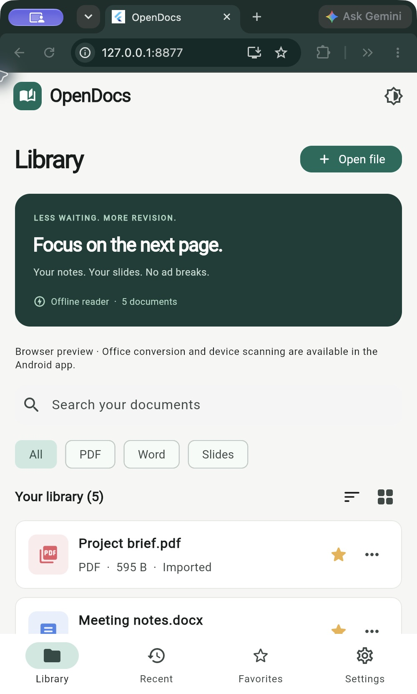
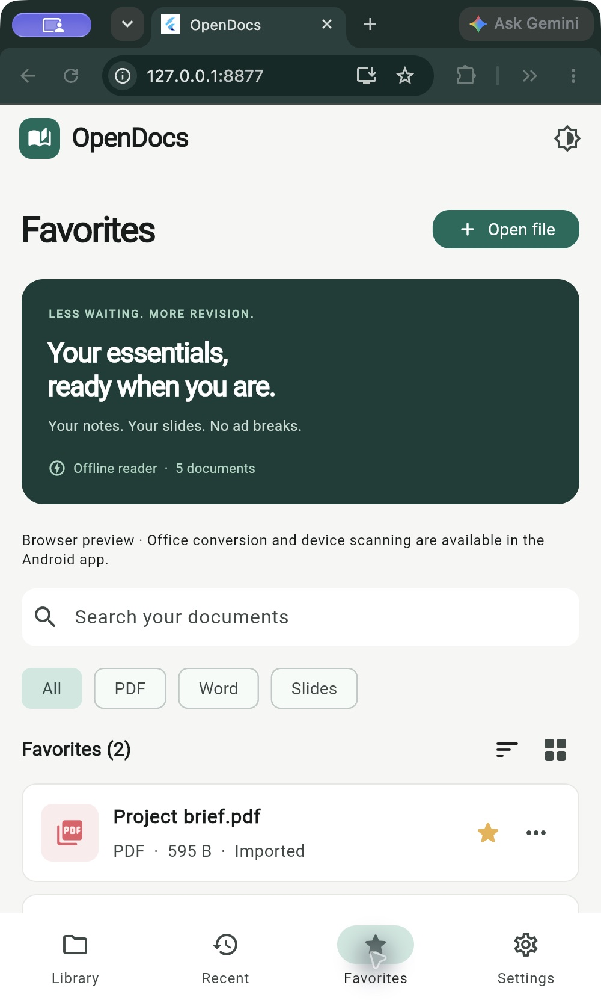
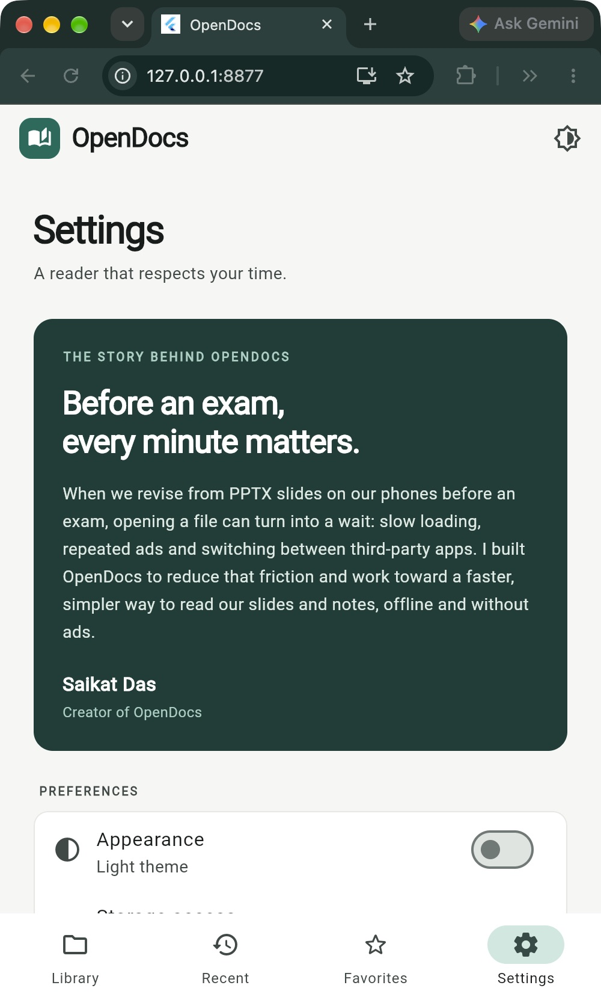

<div align="center">

# OpenDocs

### Your documents. Your device. Fully offline.

A focused Android reader for **PDF, Word and PowerPoint**, built with Flutter.
Open documents from your library, file manager or attachments, without sending them to a server.


</div>

## Read the way the page was designed

OpenDocs keeps a simple document library with search, format filters, favorites and recent files. PDFs open directly. Word pages and PowerPoint slides are rendered **on the Android device** into compressed page images and displayed through the same PDF reader. There is no cloud conversion, account, advertising or analytics service.

| Format | Reading experience |
| --- | --- |
| PDF | Native page rendering, zoom, navigation, text search and saved reading position |
| DOC / DOCX | Local Office layout → page images → PDF reader |
| PPT / PPTX | Local slide rendering → slide images → PDF reader |

Image-based Office pages do not contain searchable text. Fonts that are unavailable on the device and advanced Office features may differ from Microsoft Office. Animations, audio and video are not played.

## Screenshots

The actual Flutter app interface, captured in the local Chrome preview. The listed documents are development-only fixtures; the Android app starts with your own library and has no sample-documents option.

| Library | Favorites | Settings & creator story |
| --- | --- | --- |
|  |  |  |

## Why I built OpenDocs

Before an exam, we often revise from PPTX slides on our phones. Opening those slides can mean slow loading, repeated ads and switching between third-party apps. I built OpenDocs to reduce that friction and work toward a faster, simpler way to read our slides and notes, offline and without ad breaks.

**Saikat Das · Creator of OpenDocs**

## Everyday features

- Scan supported files after granting storage access, or choose a specific folder.
- Open individual files without granting broad storage access.
- Open or share supported documents from other Android apps.
- Zoom, navigate pages and resume reading where you stopped.
- Find documents quickly with format filters, favorites and recent history.
- Switch between light and dark themes.

Original documents are not modified. Temporary imports, metadata and converted PDFs stay in private local storage. The release manifest has no Internet permission. See [Privacy](PRIVACY.md).

## Install

The current release is **1.0.2**, targeting **ARM64 Android 7+**. The signed APK is approximately **93.6 MB**, mainly because it includes a complete offline Office engine.

For this local handoff, `OpenDocs-1.0.2-offline-arm64.apk` is next to this repository folder. When publishing on GitHub, attach that file to a GitHub Release rather than committing it to the source repository. Android may ask you to allow installation from the app used to open the APK.

**APK SHA-256**

```text
2cdb162e87f467ee46ff61841eda215b0bd389fe4b93592f1eadf5e4c87b6b60
```

## Build from source

Tested with Flutter **3.47.5**, Dart **3.13.4**, JDK **17** and Android SDK **36**. Python 3 is needed only to restore the pinned Office engine.

```bash
python3 scripts/prepare_engine.py
flutter pub get
flutter run -d <android-device-id>
```

The setup script downloads the official pinned LibreOffice Android APK, verifies its SHA-256 and extracts the ARM64 engine. The generated binaries are ignored by Git, keeping this repository small and avoiding oversized GitHub files. This download happens on the development computer; the installed app converts documents fully offline.

An existing engine download can also be used:

```bash
python3 scripts/prepare_engine.py --apk /path/to/libreoffice_131.apk
```

For a signed release, create your own keystore and an ignored `android/key.properties` file. See [Release signing](docs/RELEASE.md). Then run:

```bash
flutter build apk --release --target-platform android-arm64 --split-per-abi
```

The APK is written to `build/app/outputs/flutter-apk/app-arm64-v8a-release.apk`.

## How it works

```text
Local files / Android Open with / Share
                    ↓
        Document library and permissions
                    ↓
      PDF ───────────────→ PDF reader
      Word / PowerPoint → offline Office engine
                         → compressed page images
                         → image-only PDF reader
```

- `lib/data` manages local documents, storage access and reading metadata.
- `lib/features` contains the library and reader screens.
- `android/app/src/main/kotlin` handles Android file access and isolated Office conversion.
- `android/app/src/main/java/org/libreoffice/kit` contains matching LibreOfficeKit bindings.
- `scripts/prepare_engine.py` restores the checksum-pinned native dependency.

Word is first exported to a temporary local PDF to preserve pagination, then rasterized page by page. Slides are painted directly by LibreOfficeKit. Both paths use a maximum image long edge of 1920 pixels with JPEG quality 90. The converter processes one page at a time, caches results by file hash and prunes old conversion files when the cache exceeds 160 MiB before a new conversion. Input is limited to 128 MB and output to 250 pages/slides.

## Validation and limits

```bash
flutter analyze
flutter test
```

The interface was refreshed with a green-and-white workspace, a revision banner and compact Settings. Third-party legal notices remain available under Settings → Licenses; their full text is preserved for attribution.

The current reader passed targeted Android 15 emulator checks for DOC, DOCX, PPTX and the image-PDF reader UI. Signed release DOC/DOCX conversion was also checked. The reported eight-slide presentation was visually checked in the Android conversion path. Physical phone coverage is still pending; rendering is not guaranteed identical for every Office document.

Android protected/private folders cannot be scanned. Password-protected Office files need an unlocked copy. This project targets Android; the small web shell is a preview and does not contain the on-device Office engine.

## Engine and licensing

The app bundles LibreOfficeKit **26.2.6.3**, with matching Java bindings and preserved third-party notices. Engine downloads, SHA-256, corresponding-source links and the small binding adaptation are documented in [LIBREOFFICE_ENGINE.md](LIBREOFFICE_ENGINE.md). Full bundled notices are in [assets/OPEN_SOURCE_NOTICES.txt](assets/OPEN_SOURCE_NOTICES.txt). Third-party libraries and fonts retain their respective licenses. No blanket license for the original OpenDocs code is declared in this handoff.

## GitHub repository details

Suggested description:

> A private, fully offline Android reader for PDF, DOC/DOCX and PPT/PPTX, built with Flutter and on-device Office rendering.

Suggested topics: `flutter`, `android`, `offline`, `pdf-reader`, `docx`, `pptx`, `libreoffice`.

## Local UI preview

The optional `lib/preview.dart` entry point shows a few local development documents for UI review. It is separate from the production Android entry point.

```bash
flutter build web --no-web-resources-cdn -t lib/preview.dart
mkdir -p build/web/preview-files
cp test/fixtures/sample.* build/web/preview-files/
python3 -m http.server 8876 --bind 127.0.0.1 --directory build/web
```

Open `http://127.0.0.1:8876/` in Chrome. Full offline Office conversion and storage scanning run in the Android app.
